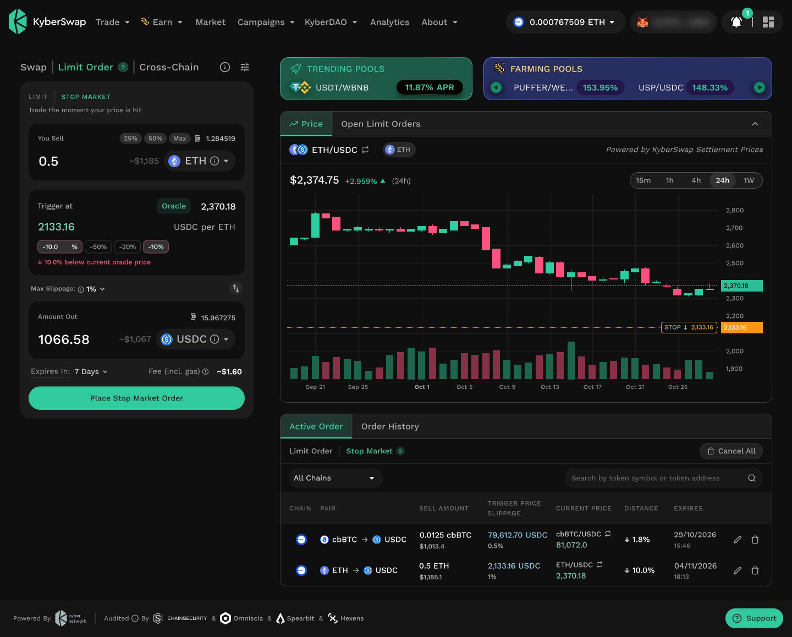
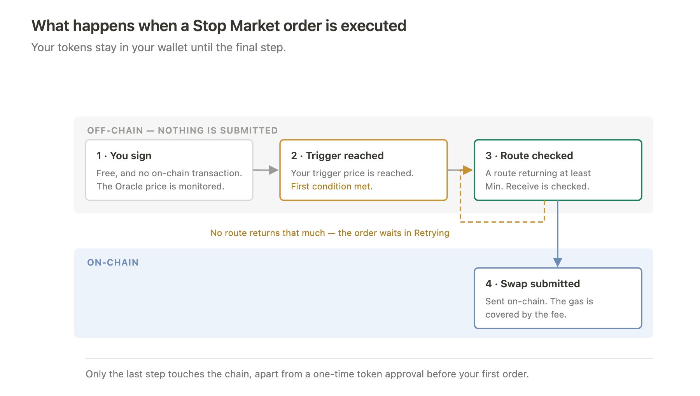
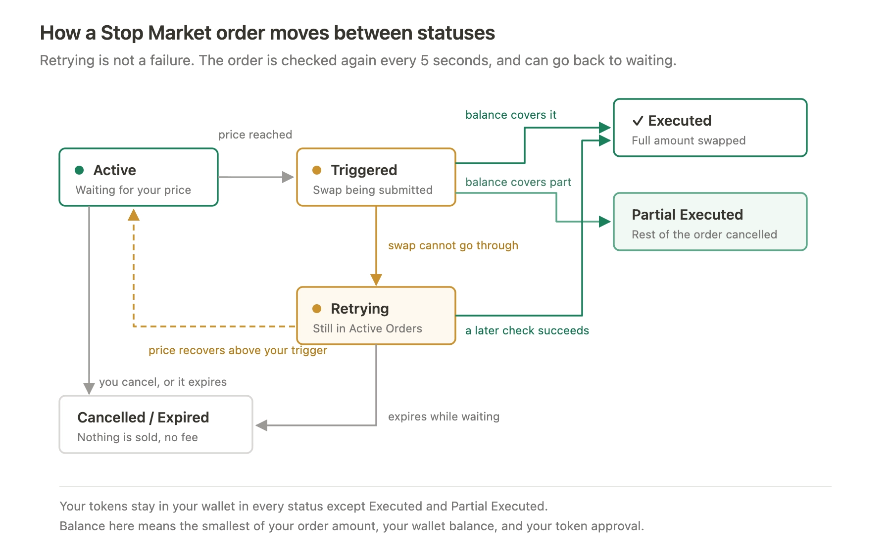

# Stop Market

## Overview

Token prices change at any time, including outside the hours you are at a screen. Without an order in place, acting on a price movement means either monitoring the market and swapping manually, or accepting the price available when you next check.

Manual monitoring has practical limits. A price alert still requires reaching a device, connecting a wallet, and completing a swap, and the price can move further while that happens.

Acting on a price condition is straightforward where the tokens are held for you. This order type is standard on centralised exchanges, and an on-chain service that takes custody can do the same: a contract holding your tokens can watch a price and swap what it holds. Either way, the tokens have to leave your wallet first.

Doing it without custody is the harder problem. If the tokens stay in your wallet, you remain free to move, spend or swap them at any time, so the order cannot rely on having them. It has to be carried out against whatever balance is available at the moment the condition is met.

A Stop Market order works that way. You set the price that should trigger the swap in advance, based on third-party price data, and the order is automatically triggered for execution at the prevailing market price when the specified price condition is met, without requiring you to be present. Your tokens stay in your wallet the whole time the order rests, and the decision is made before the market moves rather than at the moment it does.


However, triggering a Stop Market order does not guarantee its execution. Execution depends on factors such as available token balance, token approvals, market liquidity, slippage settings, and network conditions. Orders may be delayed, fail to execute, or be executed at a price different from the specified trigger price.


## What is KyberSwap’s Stop Market?

A Stop Market is an order type that automatically triggers a token swap for execution when two conditions are met: its price reaches a trigger price you set in advance as determined by Oracle price data, and the swap can return at least your accepted Min. Receive.

You set two things in advance: the price that should trigger the swap — the **trigger price** — and the slippage you are willing to accept, which fixes **Min. Receive**, the least the swap can return. Your order is checked against the Oracle price, is automatically triggered for execution once both conditions hold, without further confirmation.

The two conditions do different jobs. The trigger price decides **when** the order becomes executable. Min. Receive decides **whether** the swap goes through at that moment — if the swap would return less than that amount, the order is not executed, and it keeps retrying until the conditions are met.

<figure><figcaption>
Stop Market - Trade the moment your price is hit
</figcaption></figure>

### What are the benefits of a Stop Market?

* **The price level is set in advance.** The trigger price defines how far the market can move before the swap is triggered, and it is decided before the market moves at all.
* **The worst acceptable outcome is set in advance too.** Min. Receive is the least the swap can return. If the market cannot offer at least that much, the swap is not executed.
* **Your tokens stay in your wallet.** Nothing is locked or transferred to KyberSwap while the order rests, so the tokens remain available to use. Because they are not locked, an order covers only the balance available when it executes — see [What happens if your balance changes?](./#what-happens-if-your-balance-changes).
* **Placing and cancelling are free.** You are only charged when an order actually executes.

### How is a Stop Market different from a Limit Order?

Both order types rest until the market moves. The difference is what each one sets: a Limit Order sets the rate it trades at; a Stop Market order sets the price level at which the order is triggered for execution.

<table><thead><tr><th width="195.08984375"></th><th>Limit Order</th><th>Stop Market order</th></tr></thead><tbody><tr><td>Where you set the price</td><td>Any rate</td><td>Below the current price</td></tr><tr><td>How it is executed</td><td>A taker, who chooses to trade at your rate</td><td>Triggered for execution and routed on-chain through the KyberSwap Aggregator, once all conditions are met.</td></tr><tr><td>Executes at</td><td>Exactly the rate you set</td><td>The market price available at the execution time, less the fee, when the trigger price is reached, never below your Min. Receive Amount</td></tr><tr><td>Certainty of execution</td><td>Takers must consider the order's size, gas fees, and personal profit margin before deciding to fill an order</td><td>Triggers once the trigger price is reached; and executes when the swap returns at least your Min. Receive Amount and network gas are within an executable range.</td></tr><tr><td>Certainty of price</td><td>The rate is fixed when you create the order</td><td>Depends on the market price at the execution time, with the min amount out protection.</td></tr><tr><td>Fee</td><td>No fee for the order maker — the taker pays the gas</td><td>A fee on execution, covering the protocol fee and gas fee.</td></tr></tbody></table>

## How Stop Market works

### What are the steps?

<figure><figcaption></figcaption></figure>

1. **Set your trigger price and maximum slippage.** The trigger price is when the swap should be executable; the slippage setting fixes **Min. Receive**, the least the swap can return. Both are shown before you sign.
2. **Approve the token, then sign.** If the token has not been approved yet, your wallet first asks you to approve it - a one-time on-chain transaction per token per chain, which requires gas. Creating the order itself is a free signature and sends no on-chain transaction. Your order is then checked against the Oracle price, and your tokens stay in your wallet.
3. **The trigger price is reached.** That is the first condition met.
4. **A route is checked.** The KyberSwap Aggregator looks for a route that returns at least your Min. Receive. If none does, the swap is not submitted and the order waits in **Retrying**.
5. **The swap is submitted on-chain.** The network gas is covered by the fee, which is deducted from the tokens you receive.

Apart from a first-time token approval, only the last step touches the chain. You can edit or cancel at any point before it, free of charge and without sending an on-chain transaction.

### What decides where an order is executed?

The trigger price is set below the current price. If you want to set a trigger price above the current one, consider a Limit Order instead — it fills at exactly the rate you set, with no slippage and no fee.

For an order to be executed, conditions have to hold at the same time.

* The Oracle price reaches your trigger price, or falls below it — as determined by third-party price data. This triggers the order.
* The swap returns at least your Min. Receive. This decides whether it goes through.
* Network gas is within an executable range. The fee covers the on-chain execution cost, so an attempt is skipped if gas would take up too much of it, and resumes once gas settles.

Min. Receive is calculated based on your trigger price, maximum slippage, and fees. It is shown on the review screen before signing and represents the minimum you’ll receive if your order is executed.

Your order is checked against the Oracle price — third-party price data published on-chain — every 5 seconds, so there is a short delay between the market reaching your level and the order being triggered.

The second condition is the one that varies. The Oracle price is a reference price rather than one you can trade at, so what a swap actually returns moves with liquidity and with how fast the market is moving. When the Oracle price has reached your trigger but a swap cannot yet return your Min. Receive, the order shows as **Retrying** — it stays in your Active Orders, your tokens stay in your wallet, and it is checked again on each cycle until it is executed, expires, or you cancel it.

**Example**

The Oracle price for ETH is 2,500 USDC on Ethereum. You set a trigger of 2,000 with 2% maximum slippage, so selling 1 ETH gives a **Min. Receive of 1,957 USDC** — 2% below your trigger and after the fee.

ETH falls and the Oracle price reaches 2,000, so the first condition is met and the order is triggered. But the market is moving quickly, and at that moment a swap would return only 1,940 USDC. That is below your Min. Receive, so nothing is submitted and the order shows as **Retrying**.

The order is checked again on each cycle. A short time later the market steadies and a swap returns 1,973 USDC — above your Min. Receive — so it executes at that price. You receive more than the minimum, your tokens stayed in your wallet throughout, and nothing was cancelled.

A spike in network gas can cause the same wait, for the same reason.

### Which price does a Stop Market monitor?

A Stop Market evaluates the trigger price against an Oracle price, powered by Chainlink — a reference price published on-chain, drawn from many sources rather than from any single liquidity pool. Because of that, a manipulated pool price would not, on its own, necessarily trigger an order. For background on how Oracles work, see [Oracles](../../getting-started/foundational-topics/decentralized-technologies/oracles.md).

For further details, you can refer to Chainlink documentation: [https://docs.chain.link/data-feeds](https://docs.chain.link/data-feeds).


**The price chart and the trigger price use different sources**

The price chart is powered by [KyberSwap Settlement Prices](../../developer-guide/start-here/foundational-solutions/token-settlement-price.md), which record what actually traded on-chain. Your trigger price is evaluated against the Oracle price - the third-party price data. The two track each other closely but are not identical, so the chart may touch your trigger line slightly before or after the order becomes executable.

Your active orders are drawn on the chart with both their trigger price and the current Oracle price, so you can see the comparison that matters.


### What are the Stop Market statuses?

<figure><figcaption></figcaption></figure>

<table><thead><tr><th width="209.69921875">Status</th><th>Meaning</th></tr></thead><tbody><tr><td><strong>Active</strong></td><td>The order is being monitored and the trigger price has not been reached.</td></tr><tr><td><strong>Triggered</strong></td><td>The trigger price has been reached and the swap is being submitted.</td></tr><tr><td><strong>Retrying</strong></td><td>The trigger price was reached but the swap has not gone through. The order stays in Active Orders and is checked again on the same schedule as every other order. For more details on how Retrying works, you can refer to .</td></tr><tr><td><strong>Executed</strong></td><td>The order has been filled and is complete. The tokens received are in your wallet. An order that filled against a reduced balance is also Executed — see <a href="./#what-happens-if-your-balance-changes">What happens if your balance changes?</a>.</td></tr><tr><td><strong>Partial Executed</strong></td><td>Your balance covered only part of the order. That part was swapped and the remainder was cancelled.</td></tr><tr><td><strong>Cancelled</strong></td><td>You cancelled the order before it was executed<strong>.</strong></td></tr><tr><td><strong>Expired</strong></td><td>The order reached its expiry without the trigger price being reached.</td></tr></tbody></table>

### What happens if your balance changes?

Your tokens are not locked while a Stop Market rests, so the balance available to the order can change after you create it. The same applies to your token approval (allowance): if you revoke or lower the allowance amount, the order can use only what the approval still covers.

You can place multiple orders for the same token, as long as their combined amounts do not exceed your wallet balance. To place additional orders, you can reduce the amount of an existing order or cancel it.

An order is executed only once, for the smallest of three amounts: the order amount, your wallet balance at that moment, and your token approval (allowance).

* **If your balance and approval both cover the order**, the whole amount is swapped and the order is **Executed**.
* **If your balance or approval covers only part of it**, that part is swapped and the remainder is cancelled. The order is **Partial Executed** and does not run again.
* **If there is no balance or no approval at all**, nothing is swapped and nothing is cancelled. The order stays in your Active Orders and can still execute later, once the token is back in your wallet and approved, until it expires.

For example: You place an order to swap 1 ETH, and approve 1 ETH for it. What happens then depends on what is actually there at the moment the order is executed.

<table data-header-hidden><thead><tr><th width="338.578125"></th><th></th></tr></thead><tbody><tr><td><strong>At the moment it executes</strong></td><td><strong>What happens</strong></td></tr><tr><td>1 ETH in your wallet, 1 ETH approved</td><td>All 1 ETH is swapped. The order is <strong>Executed</strong>.</td></tr><tr><td>0.2 ETH in your wallet, 1 ETH approved</td><td>Your balance is the smallest of the three, so 0.2 ETH is swapped and the remaining 0.8 ETH is cancelled. The order is Partial Executed.</td></tr><tr><td>1 ETH in your wallet, 0.2 ETH approved</td><td>Now the approval is the smallest, and the result is the same: 0.2 ETH is swapped and the remaining 0.8 ETH is cancelled. The order is Partial Executed.</td></tr><tr><td>No ETH in your wallet <em>or</em> no approval</td><td>Nothing is swapped and nothing is cancelled. The order stays Active until it expires.</td></tr></tbody></table>

In both Partial Executed rows, the order is finished. Moving the ETH back into your wallet, or raising the approval again, does not restart it.

## Supported tokens, chain and fees

### Which tokens can be used with a Stop Market?

The token being used has to meet two conditions.

* **It has a Chainlink price feed on the chain you are using.** A Stop Market order depends on continuous price monitoring, so a token without a feed cannot be used. View the list of supported tokens by Chainlink here: [https://data.chain.link/feeds?categories=Crypto](https://data.chain.link/feeds?categories=Crypto).
* **KyberSwap has added it to the supported list for Stop Market orders.** A price feed on its own is not enough — each token is also mapped on the KyberSwap side before it becomes available.

#### Which chains are supported?

Stop Market is available on [Supported Exchanges And Networks](../../getting-started/supported-exchanges-and-networks.md).

#### What is the fee structure?

Placing, editing, and cancelling a Stop Market are free. A fee is charged only when an order executes, and it is deducted from the tokens you receive.

For the fee structure, you can refer to: [Fee Schedule](../../getting-started/fee-schedule.md#stop-market).

The fee that applies to your order is shown on the order form and again in the review screen before you confirm, as an amount in the tokens you are receiving.
