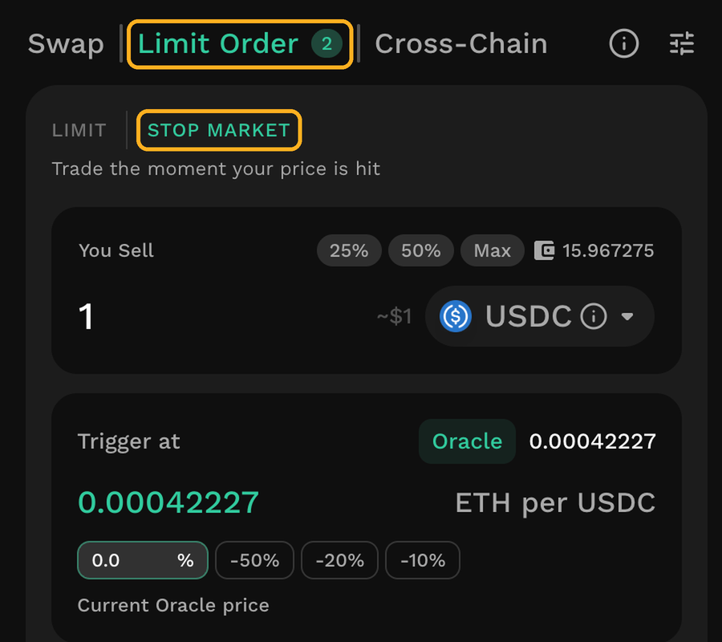
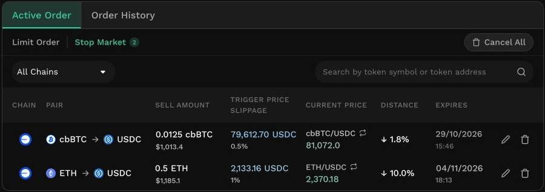

# Create Stop Market

A Stop Market order is automatically triggered for execution when two conditions are met: its price, as determined by Oracle price data, reaches a trigger price you set, and the swap can return at least your Min. Receive. Placing one is free apart from a token approval, if one is needed, and the tokens stay in your wallet until the order is executed.

<figure><figcaption></figcaption></figure>

## Step 1: Open Stop Market

Connect your wallet and select a supported network. From the top navigation, open the Limit Order tab, then select Stop Market in the sub-toggle. You can also go straight to: [https://kyberswap.com/stop-market/](https://kyberswap.com/stop-market/).

<figure><figcaption></figcaption></figure>

### Step 2: Fill in the order

Everything below happens on one form, in the order the fields appear.

<figure><figcaption></figcaption></figure>

**You Sell** — the selector lists only tokens eligible for a Stop Market order; see [Which tokens can be used with a Stop Market?](./#which-tokens-can-be-used-with-a-stop-market).

**Trigger at** — enter the price at which you want the swap to happen, as a rate for the pair.

**Amount out** — an estimate of the raw swap result at your trigger price, using today's liquidity. It is before the fee and before slippage.

**Max slippage** — the largest difference you will accept between the expected and actual execution price. The field is pre-filled with a suggested value, which you can change. This setting is what fixes **Min. Receive**, the least the swap can return. The suggested default is higher than Swap’s, because the gap between the Oracle price and the price actually available at execution can be wider than on a normal swap.

**Expires in** — how long the order should remain active. If the trigger price is not reached before then, the order becomes inactive and nothing is swapped. You can cancel at any time before expiry.


**Your balance is not locked**

The tokens stay in your wallet and remain available to use for as long as the order rests. They move only when the order is executed.

Because of that, an order covers only the balance available at the moment it is executed. If you spend or transfer the tokens, see [What happens if your balance changes?](./#what-happens-if-your-balance-changes).


## Step 3: Review and confirm

Select **Place Stop Market order** to open the review screen.

<figure><figcaption></figcaption></figure>


**How Min. Receive is worked out**

Min. Receive is calculated from your **trigger price**, less your maximum slippage and the fee.

If a swap would return less than that, the order does not fail. It keeps being attempted and shows as **Retrying** until a swap can return at least Min. Receive. When the order does execute, you receive the full output of the swap, which can be more than Min. Receive.

See [What decides where an order executes?](./#what-decides-where-an-order-is-executed) for the range an order can execute in, and how far from your trigger price it keeps being attempted.


The first time you place a Stop Market order, the screen adds an acknowledgement to confirm.

If you confirm, your wallet asks you to **approve** it first (if this is the first Stop Market order you have placed on this token) — an on-chain transaction that costs gas, and one you only do once per token per chain. After that, signing the order itself is free and sends no transaction.

Once signed, your order appears in **Active Order** below the chart.

<figure><figcaption></figcaption></figure>
