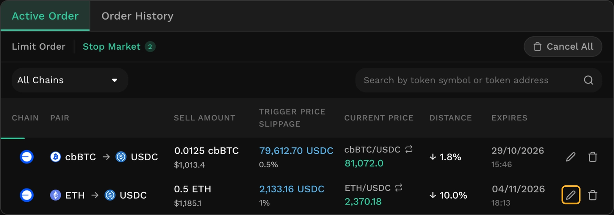
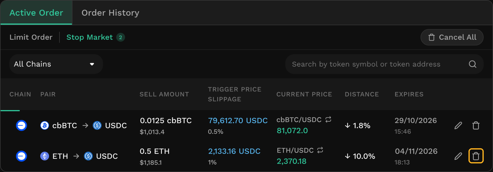
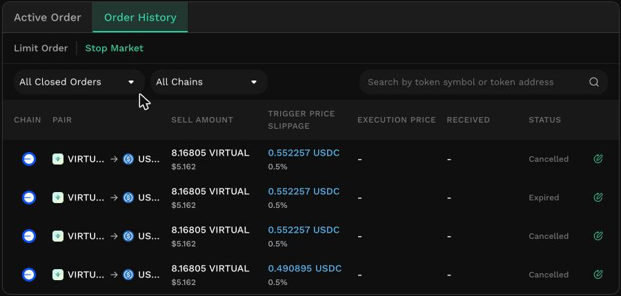

# Manage Stop Market Orders

Your orders appear below the price chart on the Limit Order tab, under Active Order and Order History. Each tab has a Limit Order | Stop Market order filter, so both order types live in one place.

## Where do I find my Stop Market Order?

Open the Limit Order tab and look below the chart. Select Stop Market in the filter row to show only Stop Market Orders, or switch the filter to see your limit orders alongside them.

<figure><figcaption></figcaption></figure>

### The trigger price was reached, but my order has not completed

This is the **Retrying** state, and it is not a failure. A Stop Market order is executed only when both of its conditions are met: the trigger price is reached, _and_ the swap returns at least your Min. Receive. Retrying means the first has happened and the second has not yet.

Every active order is checked against the Oracle price every 5 seconds, and a Retrying order is checked on the same schedule as any other. The trigger condition is re-read each time, so if the price moves back above your trigger price the order is not triggered — it goes back to waiting. There is no limit on the number of checks; the order continues until it is executed, expires, or you cancel it. Your tokens stay in your wallet throughout.

There are some common causes:

* **The swap cannot return your Min. Receive** in current market conditions, usually because your maximum slippage is too tight for how fast prices are moving. The row offers **Edit order**, which raises the slippage — and so lowers Min. Receive — while keeping your trigger price. This is the one case where you can resolve the situation yourself in a single step.
* **Your balance or token approval no longer covers the order.** The order is executed once the token is back in your wallet and approved. Note that if a _partial_ balance is available, the order is executed for that amount and completes — see [What happens if your balance changes?](./#what-happens-if-your-balance-changes).
* **Network gas is unusually high.** Executing the order would currently cost more than the fee it collects, so it is held and attempted again when gas settles. This mainly affects small orders.
* **The Oracle price was out of date.** The feed has not updated within its heartbeat, so the order waits for a fresh price — see [FAQs](faqs.md).

### How do I edit a Stop Market order?

<figure><figcaption></figcaption></figure>

Select the edit action on an order row, or **Edit order** in a Retrying message. The form reopens with the order's current values, and the fields you change are marked so you can see what you are about to re-sign.

You can change the **amount**, **trigger price**, **maximum slippage**, and **expiry**. The token pair and the receiving address cannot be changed — to change those, cancel the order and place a new one.

Confirming shows what is changing, then asks for one signature. Editing is free, and you are never asked to sign twice.


**Editing replaces the order**

An edit is handled as a cancellation and a new order behind a single signature. The replacement is a new order, so its creation time is new, and the original appears in your history.


## How do I cancel a Stop Market order?

Select the cancel action on the order row and confirm. Cancelling is free and sends no on-chain transaction. The order moves to Order History, and you can place a new one at any time.

<figure><figcaption></figcaption></figure>

## What does Order History show?

<figure><figcaption></figcaption></figure>

History lists orders that have been executed, cancelled, or expired, with the trigger price and slippage you set, the execution price, and the amount received.

Selecting a row expands it to show the full detail: execution price, minimum amount out, when the order was created and executed, the fee charged, and a link to the transaction.

Execution price will usually differ from your trigger price. Once triggered, a Stop Market order is executed at the prevailing market price available at that moment, so a gap between the two is expected rather than a problem.
