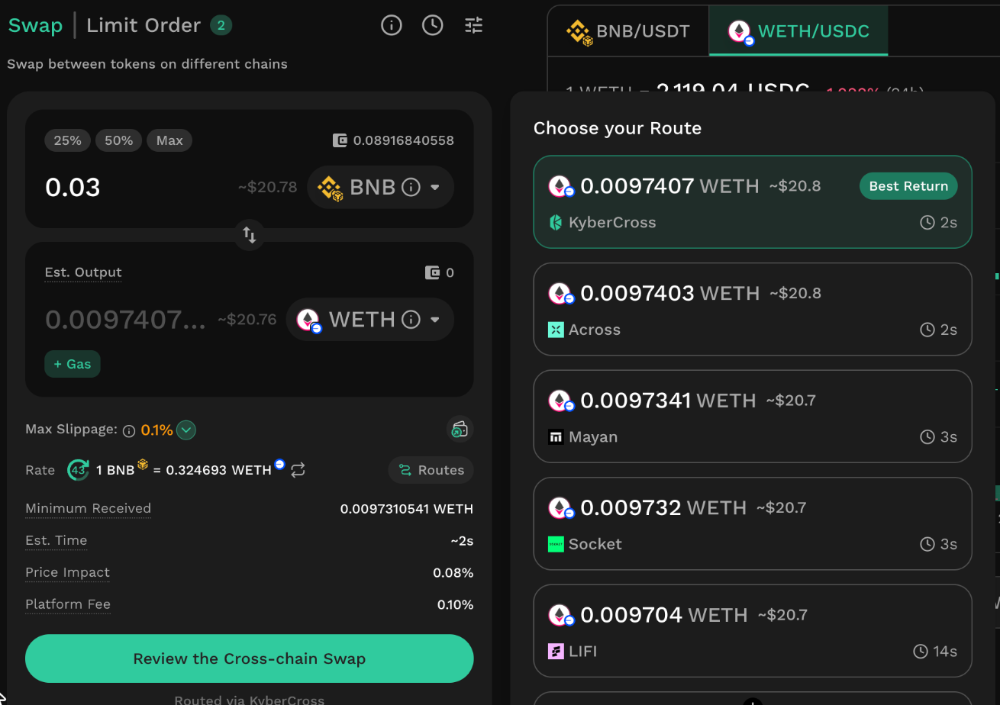

# Swap

## Overview

Swap on KyberSwap lets you swap tokens on the same network or across networks from a single interface, including EVM networks and non-EVM networks such as Bitcoin, Solana and NEAR.

KyberSwap Aggregator splits your swap across many liquidity sources to find capital-efficient routes and favourable swap rates. At the moment of the swap, Smart Settlement checks the candidate pools again and executes through the one that delivers the most output.

For cross-chain swaps through KyberCross, KyberSwap Aggregator and Smart Settlement work on both the source chain and the destination chain. In between, a bridge carries a token with deep liquidity, such as a stablecoin or ETH, from one chain to the other.

For developers, KyberSwap provides the [KyberSwap Aggregator API](../../developer-guide/aggregator-api/) for same-chain swaps and the KyberCross API for cross-chain swaps (which will be released soon). Both find a route across liquidity sources and return the transaction to submit.&#x20;


**Supported exchanges and networks**

For the full list of DEXs which have been integrated across KyberSwap Aggregator supported chains, please refer to [Supported Exchanges And Networks](../../getting-started/supported-exchanges-and-networks.md).


### What does Swap offer?

* **Rates**: KyberSwap Aggregator routes each swap across liquidity sources on the chain, including KyberSwap Limit Orders and Professional Market Maker quotes.
* **Execution**: [Smart Settlement](../../developer-guide/start-here/foundational-solutions/smart-settlement-better-swap-output-with-lower-slippage.md) checks the candidate pools again when the swap runs and uses the one that delivers the most output for each swap step.
* **KyberCross, a new cross-chain route:** KyberCross is KyberSwap's own cross-chain swap engine. It brings KyberSwap Aggregator and Smart Settlement to both the source chain and the destination chain. Compare KyberCross and third-party routes by output and estimated time within the same interface. The route with the best return is selected by default.
  * **Optional Gas drop**: On KyberCross routes, Gas drop delivers a small amount of the destination chain’s native token with your swap, so you don’t need to hold the native token on that chain beforehand. See [Gas Drop](instantly-swap-at-the-best-rate.md#gas-drop).
* **Gas-free approval with Permit**: Supported tokens can be approved with a signed message instead of an on-chain approval transaction.
* **Swap tracking**: Check the status of all your swaps in one place. Same-chain and cross-chain swaps appear in History, where you can see whether each swap is processing, completed or failed, and follow each step of a cross-chain swap until the tokens arrive.

### How does KyberSwap route a swap?

#### KyberSwap Aggregator

<figure><figcaption></figcaption></figure>

KyberSwap Aggregator connects users and applications to liquidity spread across many liquidity sources and chains. It splits and routes each trade across these sources, including AMM pools, order books, KyberSwap Limit Orders and Professional Market Makers (PMMs), to find capital-efficient routes for favourable swap rates.

At the moment of the swap, [Smart Settlement](../../developer-guide/start-here/foundational-solutions/smart-settlement-better-swap-output-with-lower-slippage.md) can check candidate pools again on-chain and use the one with the best output for each hop. It applies to swaps with slippage risk, on every chain KyberSwap Aggregator supports, and adds no fee or extra step.

For developers, the [KyberSwap Aggregator API](../../developer-guide/aggregator-api/) returns a route across liquidity sources in a single call. Developers can also customise fees and choose which token to receive them in.

**Limit Order integration**

KyberSwap Aggregator uses active KyberSwap [Limit Orders](../limit-order/) as a liquidity source, so part of a swap can be filled by limit orders when they offer a better rate. To choose which liquidity sources your swap uses, see Customizing trade parameters.

**Professional Market Maker Integration**

KyberSwap Aggregator also gets real-time quotes from a network of PMMs. PMM quotes are collected off-chain and settled on-chain only when they offer a better rate. This adds market depth to the [liquidity sources KyberSwap supports](../../getting-started/supported-exchanges-and-networks.md).

PMMs quote both the buy and sell side of a market and earn the spread between them. Because they manage liquidity actively, they can supply it efficiently and support price discovery.

#### KyberCross

<figure><figcaption></figcaption></figure>

KyberCross is KyberSwap's cross-chain swap engine, built with KyberSwap Aggregator at its core. It uses the same routing as a same-chain swap on KyberSwap on both sides of a cross-chain swap, with a bridge step in between. KyberCross works as a route provider: it quotes the best available rate it finds for your swap, shown as one KyberCross route in the route list alongside third-party providers.

**How a KyberCross route works**

1. **Swap on the source chain:** KyberSwap Aggregator swaps your token into a high-liquidity bridge token, such as a stablecoin or ETH.
2. **Bridge:** KyberCross compares quotes from its bridge providers and chooses the one with the highest output to move the bridge token to the destination chain.
3. **Swap on the destination chain:** KyberSwap Aggregator swaps the bridge token into the token you selected.

Both swap steps are routed the same way as a same-chain swap on KyberSwap, including Smart Settlement where it applies. If your token is already the bridge token, that swap step is skipped. If both tokens are the bridge token (for example, USDC → USDC), the route is a bridge only.

**Bridge providers**\
Across, Mayan, NEAR Intents, Relay, Circle CCTP v2, Chainlink CCIP, Lifi Intent, Eco, Symbiosis, Socket.

#### Cross-chain Swap with third-party providers

Cross-chain swaps can also route through third-party cross-chain providers: NEAR Intents, Across, Relay Protocol, deBridge, LI.FI, Mayan Finance, Bungee and Symbiosis. KyberSwap fetches their quotes in real time and shows the option with the highest output by default. These routes also cover non-EVM networks such as Bitcoin, Solana and NEAR.

<figure><figcaption></figcaption></figure>
