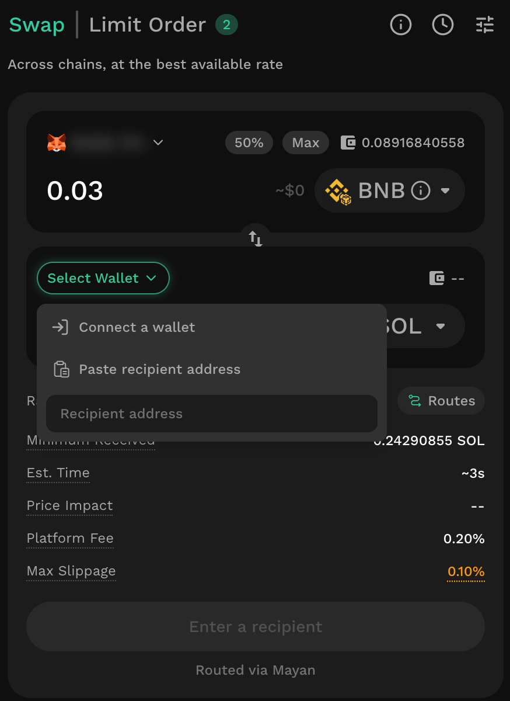
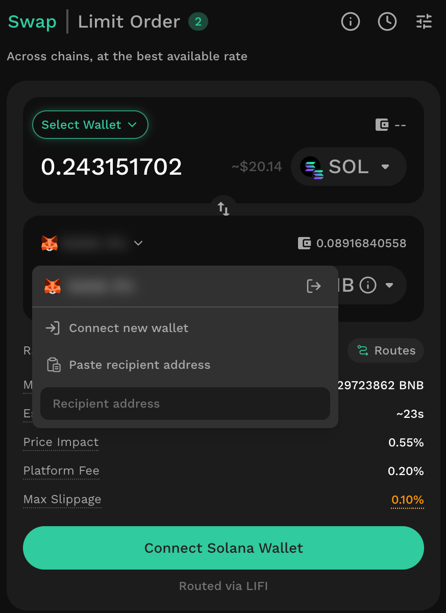
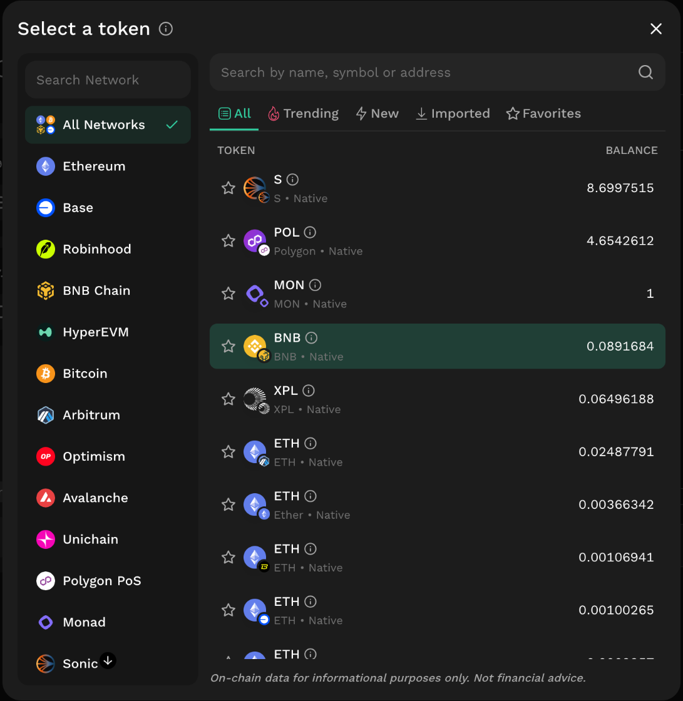
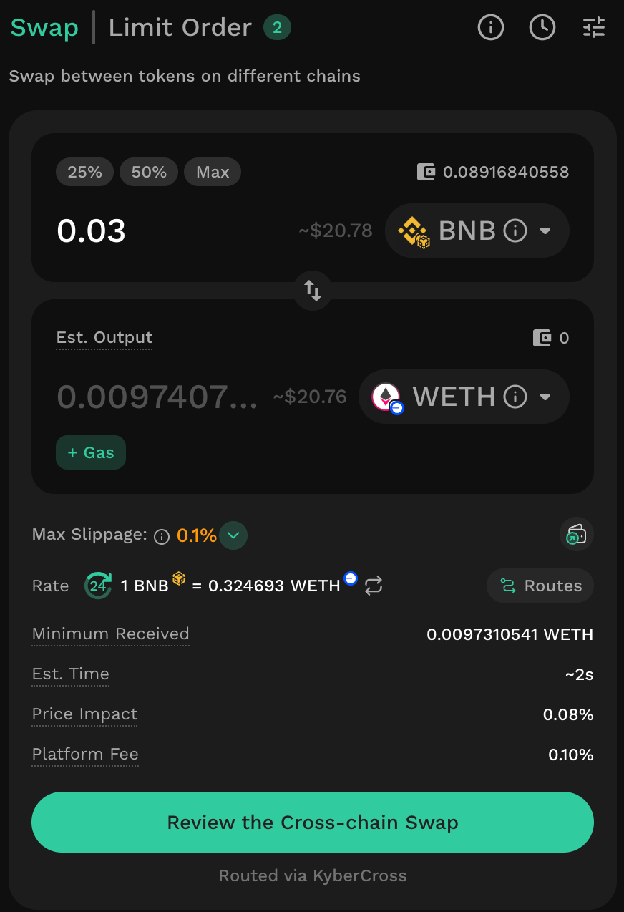
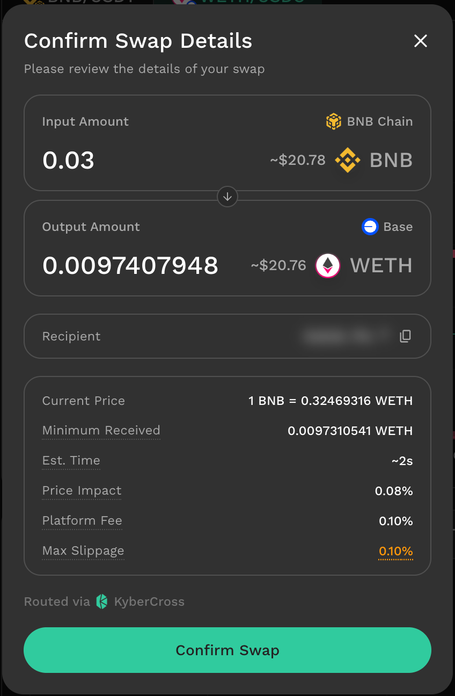
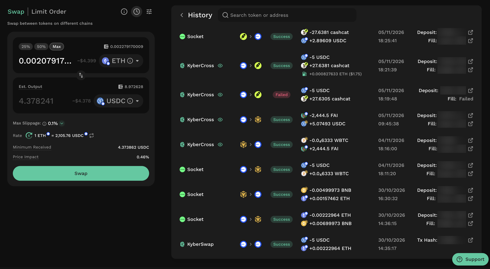
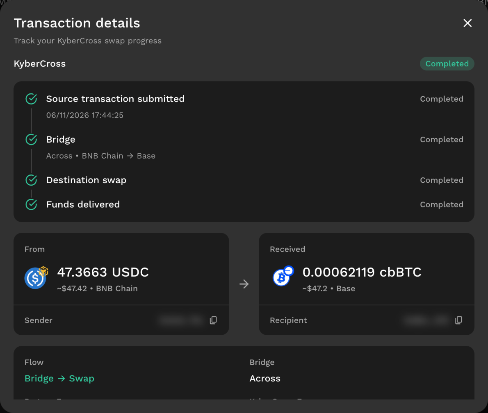
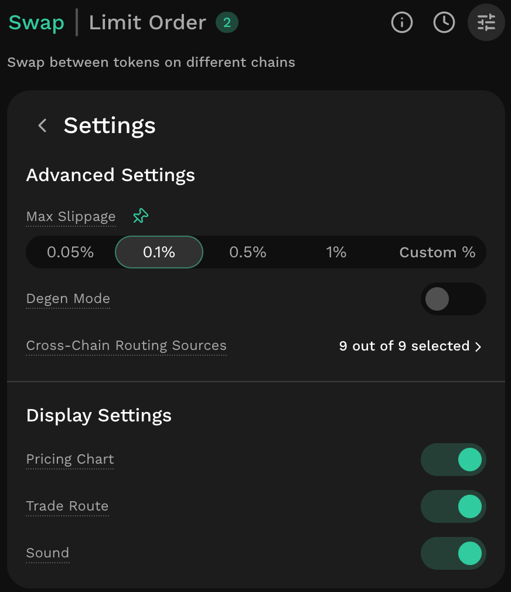
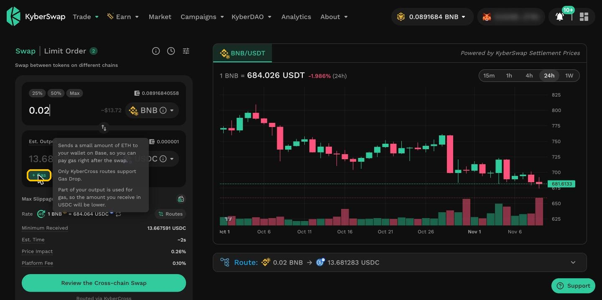
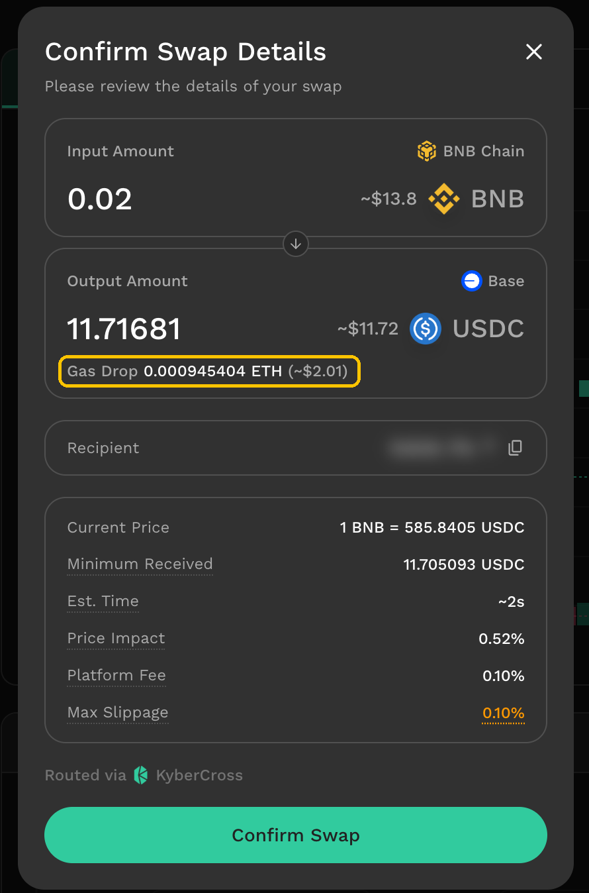

# How to Swap

Swap on KyberSwap uses one interface for same-chain and cross-chain swaps. This guide walks through the steps to complete a swap, the options available for cross-chain swaps, the trade parameters you can adjust, and how to follow your swap after you confirm it.

Please refer to [Supported Exchanges and Networks](../../getting-started/supported-exchanges-and-networks.md) for the full list of supported networks.

### **Step 1: Connect your wallet**

Click **Connect Wallet** in the top right corner. What else you need depends on where you swap from:

**From an EVM network**

* To an EVM network: the connected wallet sends and receives the tokens. To receive in a different wallet, use the **Recipient (EVM address)** field below the rate (see **Send to another wallet** in step 3). Recipient (EVM address) field for an EVM-to-EVM swap
* To a non-EVM network (for example, Solana): click **Select Wallet** in the receive field, then choose **Connect a wallet** to connect a wallet for that network, or **Paste receiver address** and enter an address on that network. Select Wallet menu in the receive field for a Solana destination

<figure><figcaption></figcaption></figure>

**From a non-EVM network (for example, Solana)**

<figure><figcaption></figcaption></figure>

* Click **Select Wallet** in the top field or **Connect Solana Wallet**. Connecting a Solana wallet to swap from Solana
* To receive on an EVM network: your connected EVM wallet is used by default. To change it, click it in the receive field, then connect another wallet or paste a receiver address. Receiving wallet options for a Solana-to-EVM swap

### **Step 2:** Choose the tokens and networks

<figure><figcaption></figcaption></figure>

Choose the chain and token you want to swap from and the chain and token you want to receive.

To discover newly whitelisted and trending tokens, see [Token Discovery](token-discovery.md).


**Fee-on-transfer tokens**

Note that certain ERC20 token smart contracts implement a fee-on-transfer (FOT) mechanism whereby for every token transfer, a percentage of the tokens are burned or distributed to various wallets. As a permissionless dapp, KyberSwap enables users to [Add Their Favourite Tokens](../user-guides/add-your-favourite-tokens.md) and hence do not limit the type of tokens traded as long as the token follows the [ERC20 standard](https://docs.openzeppelin.com/contracts/4.x/erc20).

Specific to swaps against [AMM DEXs](https://github.com/KyberNetwork/kyberswap-documentation/blob/main/kyberswap-solutions/kyberswap-interface/user-guides/broken-reference/README.md), tokens undergo multiple hops between various smart contracts during the course of a single swap. Multiple contracts are required to ensure the security of the swap as well as the accountability that accompanies clear functional separation between different smart contract teams. Given that FOT tokens are designed to charge a tax on every transfer, each token hop will incur a tax which is usually a percentage of the transfer amount.

For standard AMM swaps, the FOT tax will be charged twice as tokens are transferred from the pool contract to the executor contract to the recipient. If the swap involves a commission fee (configured by integrators or referees), an additional hop to the router contract is required to collect the fees.

For swaps, the token transfer happens after the swap logic has been processed based on the market price (i.e. calculating input/output amount). As such, the party that incurs the FOT tax will be dependent on the direction of the swap:

* For standard token to FOT token trades, the trader will receive FOT token minus the FOT tax.
* For FOT token to standard token trades, the pool will receive FOT token minus the FOT tax. Traders will not incur the FOT tax in this case.

Note that the FOT tax is specified in the FOT token's smart contract (i.e. the FOT token team) hence KyberSwap does not have any control over the FOT mechanism. Users are advised to trade such tokens at their own risk as KyberSwap was optimized to handle the standard ERC20 implementation.


### **Step 3**: Check the quote

Below the amounts, the swap interface shows the rate, the minimum received amount, the price impact and the max slippage.

* **Max Slippage:** click it to pick a preset or enter a custom value. See [Customizing trade parameters](instantly-swap-at-the-best-rate.md#customizing-trade-parameters).
* **Rate:** the current exchange rate (click 🔁 to invert).
* **Minimum Received:** the least you will receive after slippage and fee. If the trade would return less, it reverts.
* **Price Impact:** how much your trade moves the market price.

Cross-chain swaps also show **Estimated Time**, **Platform Fee**, and **Cross-chain Swap Provider**.

<figure><figcaption></figcaption></figure>


**Rate refresh and quote validity**

The rate on the swap screen refreshes automatically as market conditions change. Each quote is valid for a short time. If it expires before you confirm, go back and review the swap again to get a new quote. When you continue, Confirm Swap Details shows the final rate (step 5).


KyberSwap Interface allows users to customize trade parameters which enables greater trade security or even more advanced trade strategies. Refer to [Customizing trade parameters](instantly-swap-at-the-best-rate.md#customizing-trade-parameters) section for more details.


**Max slippage: Protecting your trades**

KyberSwap enables you to avoid any negative trade outcomes by setting a Max Slippage. Please refer to [Customizing trade parameters](instantly-swap-at-the-best-rate.md#customizing-trade-parameters) section for more details.


Before you review, you can also:

* **Choose another route.** Click **Routes** to open **Choose your Route**. Each route shows the amount you receive, the provider and the estimated time; some providers also show their own fee. **Best Return** marks the route with the highest output and is selected by default. **Fastest** marks the route with the shortest estimated time.
* **Send to another wallet** (EVM destinations). Click **Recipient (EVM address)**. The field shows your connected address; you can paste a different an address on the destination network. For a non-EVM destination, set the receiving address as described in step 1.
* **Add Gas drop** (KyberCross routes only). Get about $2 of the destination network's native token with your swap. A small extra fee applies, already included in the rate. See [Gas drop](instantly-swap-at-the-best-rate.md#gas-drop).

### **Step 4**: Approve or permit contract to swap tokens

Before you swap a token, you need to approve it. If the token isn't approved yet, the swap button asks you to approve it. Click it and approve in your wallet. Once approved, the button changes to **Swap** or **Review the Cross-chain Swap**. If your wallet is on a different network, it first asks you to switch network.

* **Same-chain swap:** you approve each token once for KyberSwap.
* **Cross-chain swap:** each route provider (KyberCross or a third-party provider) uses its own contract, so you approve each token separately for each provider. If you switch to a route from another provider, you may be asked to approve the same token again.
* Native tokens, such as ETH, don't need approval.
* Some tokens support **Permit**: you sign a message instead of sending an approval transaction, so the approval itself needs no gas. See [Permitable Tokens](../../reference/permitable-tokens.md) for the full list of tokens that support the ERC-2612 standard.


**Permitable tokens**

Please refer to [Permitable Tokens](../../reference/permitable-tokens.md) for the full list of tokens which have implemented the ERC-2612 standard.


### **Step 5**: Review the swap and confirm

Click **Swap** for a same-chain swap, or **Review the Cross-chain Swap** for a cross-chain swap. **Confirm Swap Details** opens. Review the details. If you agree and want to proceed, click **Confirm Swap**.

<figure><figcaption></figcaption></figure>


**Route confirmation and market volatility**

Confirm Swap Details shows the final rate for your swap. If you want to update to the latest price, close the pop-up and review the swap again.\
After you confirm, the swap only goes through if the amount you receive stays within your Max Slippage.



**Price impact**

Do take note of the resulting price impact of your trade as this will determine the final average price of your trade. Higher trade volumes relative to available liquidity will result in each additional token unit being acquired at a higher price. As such, a higher price impact would result in subpar swap rates.

Please refer to the [Price Impact](../../getting-started/foundational-topics/decentralized-finance/price-impact.md) page for further details. Consider [placing a limit order](../limit-order/) instead.



**Fees:** KyberSwap interface charges no fee on same-chain swaps. If an additional fee appears during a same-chain swap, **it is not charged by KyberSwap**.

Cross-chain swaps include a platform fee, shown clearly on the interface before you confirm. See [Fees](../../getting-started/fee-schedule.md#cross-chain-swap).


### Step 6: Track the Swap

To check your swaps later, click the history icon next to the settings icon. History lists both same-chain and cross-chain swaps.

<figure><figcaption></figcaption></figure>

For the swap routed through KyberCross, click the view icon next to KyberCross to see its full details.

<figure><figcaption></figcaption></figure>

#### What does each status mean?

<table><thead><tr><th width="183.40234375">Status</th><th>Meaning</th></tr></thead><tbody><tr><td>Processing</td><td>The transaction is in progress, including the swap on the source chain, bridging, and settlement on the destination chain.</td></tr><tr><td>Success</td><td>The swap completed, and the tokens arrived at the receiving address.</td></tr><tr><td>Failed</td><td>The swap could not be completed. If it failed on the source network, the transaction is reverted and your input tokens stay in your wallet. See <a href="instantly-swap-at-the-best-rate.md#what-happens-if-a-cross-chain-swap-fails">What happens if a cross-chain swap fails?</a></td></tr><tr><td>Refunded</td><td>The swap couldn't be completed as quoted, and the funds were returned. Depending on where the swap stopped, the token you receive or the network you receive it on may differ from the token and network you swapped from on the source chain. See <a href="instantly-swap-at-the-best-rate.md#what-happens-if-a-cross-chain-swap-fails">What happens if a cross-chain swap fails?</a></td></tr></tbody></table>

#### What happens if a cross-chain swap fails?

What you receive depends on which step of the route fails. The swap's steps in History show where it stopped.

<table><thead><tr><th width="181.2578125">Where it fails</th><th>KyberCross route</th><th>Third-party route</th></tr></thead><tbody><tr><td><strong>Source chain</strong></td><td>The transaction reverts. Your tokens stay in your wallet; only the network fee is spent. Status: <strong>Failed</strong>.</td><td>The transaction reverts. Your tokens stay in your wallet; only the network fee is spent. Status: <strong>Failed</strong>.</td></tr><tr><td><strong>Bridge</strong></td><td>The swap does not reach the destination network. The swap shows <strong>Processing</strong> ("Waiting for provider refund") until it ends as <strong>Refunded</strong> or <strong>Failed</strong>. The bridge provider returns the funds to your sending wallet on the source network.</td><td>Handled by the provider under its own process.</td></tr><tr><td><strong>Destination chain</strong></td><td>You receive the bridged token (for example, USDC) on the destination network instead of the token you selected. Status: <strong>Refunded</strong>.</td><td>Handled by the provider under its own process.</td></tr></tbody></table>

If Gas drop is on, see [Gas drop](instantly-swap-at-the-best-rate.md#gas-drop).

#### **What should I do if my swap is stuck?**

Contact KyberSwap's Customer Support by creating a ticket in **#create-ticket** on [Discord](https://discord.gg/kyberswap).

⚠️ **Beware of scammers.** KyberSwap's Customer Support team never sends you a direct message first, and never asks for your seed phrase or private key.

## Customizing trade parameters

<figure><figcaption></figcaption></figure>

The KyberSwap Interface also provides additional features for more advanced traders that allow customisation of the following trade parameters:

* **Max Slippage:** The maximum amount of slippage before the trade is reverted. Slippage refers to the difference between the expected and final price at which the trade was executed. As market conditions can change between the submission and execution of the trade, this guarantees that the trade will only be executed if the final price is within the expected price interval. For more details on slippage, refer to our [Foundational Topics](../../getting-started/foundational-topics/decentralized-finance/slippage.md).


**Max Slippage setting**

While KyberSwap recommends keeping the Max Slippage as low as possible to ensure that trades are executed at favourable rates, such transactions might face a higher failure rate in times of extreme market volatility.

Setting a higher Max slippage increases the likelihood of transaction success but comes with greater risks of worse rates due to market volatility as well as the presence of frontrunning opportunities. **KyberSwap highly recommends setting a Max Slippage for all swaps to protect your trades.**


* **Transaction Time Limit:** The amount of time from submission that the transaction is valid for. If the transaction is not executed within the specified time frame, the transaction will be cancelled.
* **Degen Mode:** Refer to [Degen Mode](instantly-swap-at-the-best-rate.md#degen-mode-tread-carefully) section below.
* **Cross-Chain Routing Sources:** the providers a cross-chain swap can route through: KyberCross, and other third-party providers. By default, all sources are selected. Turn a source off to leave it out of your quotes.
* **Liquidity Sources:** the liquidity sources a same-chain swap can route through. By default, all supported sources on the network are selected.

Display Settings let you show or hide the Pricing Chart and Trade Route, and turn Sound on or off.

### Degen Mode: Trade carefully

KyberSwap implemented Degen Mode for our most "advanced" apes. While KyberSwap has consistently iterated upon industry-leading safeguards to enable our users to trade safely, we are aware that some advanced traders might find these protective features inconvenient. As such, switching to Degen Mode allows users to conduct high impact trades without any confirmation prompts nor price impact limits.


**Price deviations**

Note that even with Degen Mode turned on, any significant price deviations that occurs while the swap is being secured will still require user confirmation. Please refer to [Route confirmation and market volatility](instantly-swap-at-the-best-rate.md#step-5-confirm-the-swap) for more details.


#### Overriding safeguards

By turning on Degen Mode, multiple safeguards will be overridden allowing users to:

* Configure max slippage ≥ 20% and ≤ 50%
* Confirm trades with price impact ≥10%
* Proceed with swaps when price impact is unable to be calculated

#### Activating Degen Mode


**Advanced traders only**

Tread carefully when turning on Degen Mode as [slippage](../../getting-started/foundational-topics/decentralized-finance/slippage.md) and [price impact](../../getting-started/foundational-topics/decentralized-finance/price-impact.md) risks are not conservatively capped which could result in significant losses. **KyberSwap recommends that users only activate Degen Mode if you are fully aware of the risks of unprotected trades.**


As a safety precaution, Degen Mode will be auto-disabled after 30 minutes of being switched on.

### Gas drop

<figure><figcaption></figcaption></figure>

Gas drop is an optional add-on for cross-chain swaps routed through KyberCross. It sends about $2 of the destination network's native token (for example, ETH on Arbitrum or HYPE on HyperEVM) to your receiving wallet together with your swap, so you have gas for a transaction on that network after the swap.

To use Gas drop, you need to turn it on.

**How it works**

* Gas drop runs in KyberCross's destination swap step. After the bridge step, part of the bridged token is swapped into the destination network's native token and sent to your receiving wallet.
* Your input amount stays the same. The gas drop comes out of your output, so the amount you receive of your selected token is lower - which is shown transparently on the confirmation box before confirming.

<figure><figcaption></figcaption></figure>

* Gas drop is only available on KyberCross routes. If your swap uses a third-party route, turning on Gas drop switches it to a KyberCross route.
* Gas drop isn't available for same-network swaps, when the token you receive is already the native token, when the source or destination network is non-EVM, or when no KyberCross route is available for the swap.


Gas drop adds a small extra protocol fee to cover the gas of the extra swap on the destination network. The fee is paid in that network's native token and is calculated as approximately:\
`Gas drop fee ≈ 2,000,000 × current gas price on the destination network`\
Because gas prices change with network conditions, the fee changes too. For example, on Arbitrum at a gas price of 0.020078 gwei: 2,000,000 × 0.020078 gwei ≈ 0.000040156 ETH (around $0.08).\
This fee isn't shown as a separate line. It is already deducted when the quote is calculated, so the rate and the amount you receive on the swap screen already account for it.


**If the swap fails**

Gas drop only runs once your tokens reach the destination network.

| Where it fails            | Main swap                             | Gas drop    | What you receive                                                                                                             |
| ------------------------- | ------------------------------------- | ----------- | ---------------------------------------------------------------------------------------------------------------------------- |
| **Source chain**          | Doesn't run. The transaction reverts. | Doesn't run | Your tokens stay in your wallet                                                                                              |
| **Bridge**                | Doesn't reach the destination network | Doesn't run | See [What happens if a cross-chain swap fails?](instantly-swap-at-the-best-rate.md#what-happens-if-a-cross-chain-swap-fails) |
| **Gas drop only**         | Success                               | Failed      | Your selected token, plus about $2 as the bridged token (for example, USDC)                                                  |
| **Destination swap only** | Refunded                              | Delivered   | The native gas, plus the bridged token                                                                                       |
| **Both**                  | Refunded                              | Failed      | The full amount as the bridged token                                                                                         |
